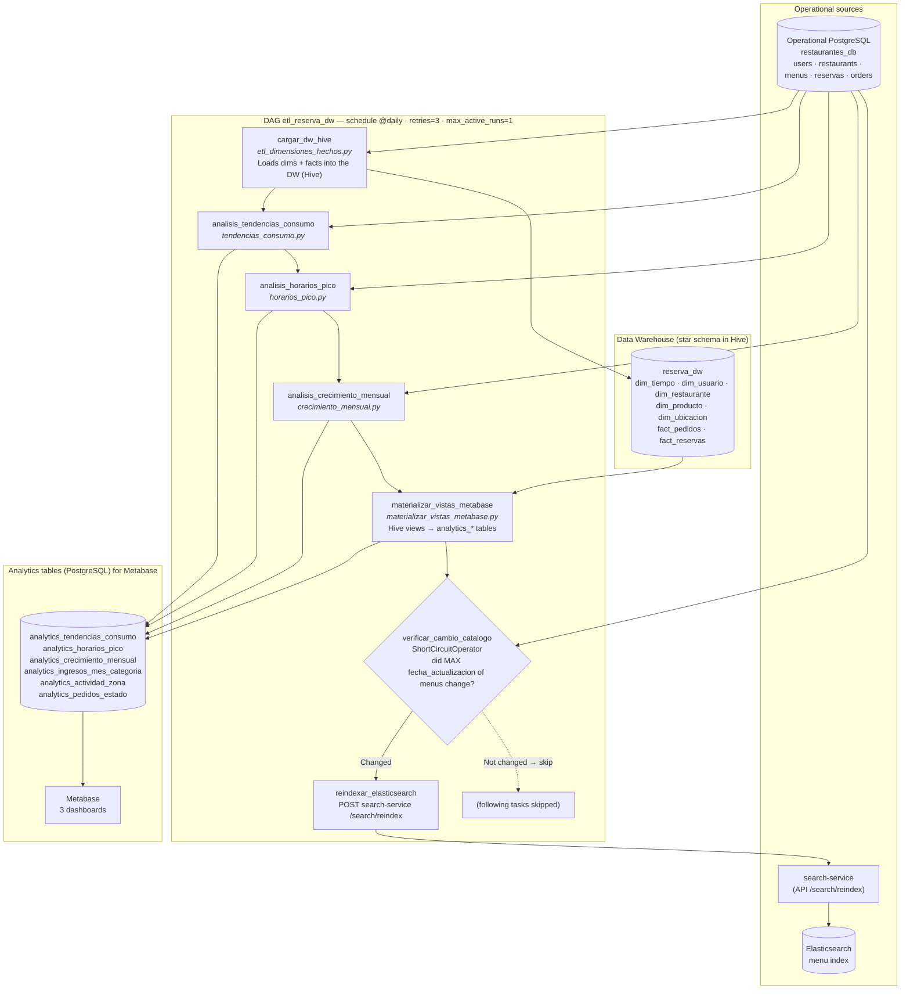
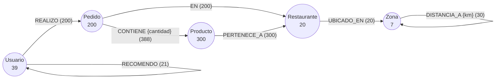
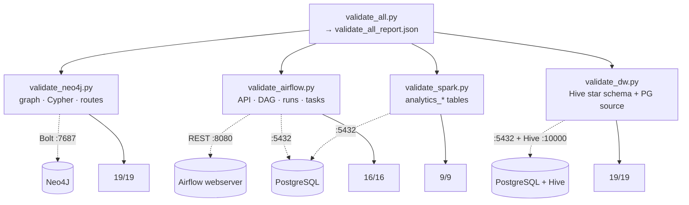

<h1 align="center">SmartReserve</h1>

<p align="center">
  
  
  
  
  
  
  
  
  
  
  
  
  
  
</p>

<p align="center">
  <a href="docs/README_espanol.md">Versión en español</a>
</p>

Efficient management of reservations and orders in restaurants requires a centralized platform that integrates secure authentication, multiple database engines, advanced search, and the ability to scale horizontally. This project implements a professional REST API that addresses all of these aspects through a modern technology stack and design patterns recognized in the industry.

This project builds a complex backend system that integrates CI/CD, MongoDB sharding and replica sets, Redis, Elasticsearch, Nginx, and DAO patterns to use two databases.

---

## Authors

- Christopher Daniel Vargas Villalta — 2024108443  
- Santiago Espinoza Rendon — 2024156530

---

## Video Link

This link contains everything: the video, the PDF, and all the code.

[Demo video on Google Drive](https://drive.google.com/drive/folders/1JhWkfgqhB1LY0vh_wJm4GzSwQ3yHh7LF?usp=sharing)

---

## Technology Stack

### Backend and API
- **Python 3.11** — Version used in the CI/CD pipeline and Docker containers.
- **FastAPI** — High-performance web framework to build REST APIs with automatic data validation through Pydantic and interactive documentation at `/docs`.

### Authentication and Security
- **AWS Cognito** — Fully managed authentication service. It handles user registration and the issuing and validation of JWT tokens with role-based access control (RBAC).

### Databases
- **PostgreSQL 15** — Main relational engine. It is used with the SQLAlchemy ORM for object-relational mapping.
- **MongoDB 7** — Document-oriented NoSQL engine. It is used with PyMongo, with Sharding + Replica Set support in Kubernetes.
- **DAO Pattern** — Allows switching between PostgreSQL and MongoDB by changing only the `DATABASE_TYPE` variable in the `.env`, without touching the business code.

### Cache
- **Redis 7** — In-memory database used as a cache layer. It stores frequent responses with a configurable TTL to reduce the load on the main database. It implements the Cache-Aside pattern.

### Search
- **ElasticSearch 8.15** — Full-text search engine. Menus are indexed automatically and exposed through an independent microservice (`search_service`) with endpoints to search by text and by category.

### Containerization and Orchestration
- **Docker** — Containerization of every service with reproducible images.
- **Docker Compose** — Local development environment with PostgreSQL and the main API.
- **Kubernetes** — Production orchestration. It manages replicas, horizontal scaling, persistent storage, and automatic failure recovery.

### CI/CD
- **GitHub Actions** — Automated pipeline that runs the tests and publishes Docker images on every `push` to `main`. The pipeline has two jobs: tests (with coverage ≥ 90%) and image build/publishing.
- **GitHub Container Registry (GHCR)** — Docker image registry available at `ghcr.io/owner/repo`.

### Load Balancing
- **Nginx** — Acts as a reverse proxy and load balancer. It is the only entry point to the system (port 80). It routes `/api/**` to the main API and `/search/**` to the search microservice.

### Testing
- **Pytest + pytest-cov** — Testing framework with coverage measurement. The project keeps global coverage above 90%.

---

## System Architecture

The system is made up of the following microservices and components:

```
HTTP Client
    ↓
Nginx (Load balancer :80)
    ├── /api/**  → Main FastAPI API (2+ replicas)
    │               ├── AWS Cognito (JWT authentication)
    │               ├── PostgreSQL / MongoDB (persistence)
    │               └── Redis (cache)
    └── /search/** → Search Service FastAPI
                        └── ElasticSearch (menu index)

CI/CD: GitHub Actions → GHCR (Docker images)
Orchestration: Kubernetes (namespace: reservainteligente)
```

---

## System Flow



### Neo4j Flow



### Testing Flow


---

## Roles and Permissions

The system handles two roles in the local database (`users.rol`):

| Role | Permissions |
|-----|----------|
| `cliente` | Create reservations and orders. View their own data. |
| `admin` | Create and manage their own restaurants and menus. View the orders and reservations of their restaurants. |

- **Register as a client:** `POST /auth/register` without sending `rol`.
- **Register as an admin:** `POST /auth/register` with `rol: "admin"` and the `admin_code` field if `ADMIN_REGISTRATION_CODE` is set in the `.env`.
- **Master Admin:** For an admin to manage other users (update/delete), they must send the `X-Master-Admin-Code` header with the value of `MASTER_ADMIN_CODE` from the `.env`.

---

## Installation

### Prerequisites

- Python 3.11
- Docker and Docker Compose
- kubectl and kind (for Kubernetes)
- AWS account with Cognito configured
- Git

### Step 1: Clone the Repository

```powershell
git clone https://github.com/chris124v/Reserva_Inteligente.git
cd Reserva_Inteligente
```

### Step 2: Configure the Environment Variables and Secret

Copy the example file and fill it in with the real values:

```powershell
copy .env.example .env
```

Important variables of the `.env`:

```dotenv
DATABASE_TYPE=postgresql          # or mongodb to use MongoDB
DATABASE_USER=postgres
DATABASE_PASSWORD=tu_password
DATABASE_NAME=restaurantes_db
MONGODB_URI=mongodb://localhost:27017
AWS_COGNITO_REGION=us-east-2
AWS_COGNITO_USER_POOL_ID=us-east-2_xxxxxxxx
AWS_COGNITO_CLIENT_ID=xxxxxxxxxxxxxxxxxx
REDIS_HOST=redis-service
REDIS_TTL=60
ELASTICSEARCH_URL=http://elasticsearch:9200
```

Do the same with the secret.yaml file: add it with the real data at kubernetes/config/secret.yaml, based on the example file but with real data.

### Step 3: Create and Activate the Virtual Environment

```powershell
python -m venv .venv
.venv\Scripts\Activate.ps1
pip install --upgrade pip
pip install -r app/requirements.txt
```

### Step 4: Run on Kubernetes (Full Environment)

The Kubernetes environment includes every service: API, MongoDB with Sharding, Redis, ElasticSearch, and Nginx.

These would be the manual commands

```powershell
# Create the namespace
kubectl apply -f kubernetes/namespace.yaml

# Deploy the configuration
kubectl apply -f kubernetes/config/

# Deploy the databases
kubectl apply -f kubernetes/databases/mongodb/sharding/
kubectl apply -f kubernetes/databases/postgres/
kubectl apply -f kubernetes/databases/redis/
kubectl apply -f kubernetes/databases/elasticsearch/

# Deploy the APIs
kubectl apply -f kubernetes/api/main-api/
kubectl apply -f kubernetes/api/search-service/

# Deploy the load balancer
kubectl apply -f kubernetes/balancer/
```

With this initialization script everything is ready by following this flow in the terminal: 

### 1. Deploy (deploy-all.ps1)

```powershell
.\deploy-all.ps1
```
Deploys everything: namespace, configuration, databases, and API.

### 2. Clean up (cleanup-all.ps1)

```powershell

Set-ExecutionPolicy -Scope Process -ExecutionPolicy RemoteSigned
powershell -ExecutionPolicy Bypass -File .\cleanup-all.ps1

.\cleanup-all.ps1
```
Deletes every resource. It asks for confirmation first, just in case. The first execution policy command is there in case it does not work with a single command.

### 3. Status (status.ps1)

```powershell
.\status.ps1
```
Checks the status of the whole environment.

To access the system from the local machine:

```powershell
kubectl port-forward service/nginx-service 8080:80 -n reservainteligente
```

Then go to `http://localhost/api/docs` and `http://localhost/search/docs`.

---

## Step 5: Switch the Database Engine

The DAO pattern allows switching between PostgreSQL and MongoDB without modifying the code:

```dotenv
# In the .env:
DATABASE_TYPE=mongodb      # uses MongoDB
DATABASE_TYPE=postgresql   # uses PostgreSQL
```

Change the same value in kubernetes/config/configmap.yaml

```dotenv
# In the configmap.yaml:
DATABASE_TYPE=mongodb      # uses MongoDB
DATABASE_TYPE=postgresql   # uses PostgreSQL
```

To apply the changes at once
```powershell
kubectl apply -f kubernetes/config/configmap.yaml
```

We can also do a git push to upload everything to GHCR and then run deploy all, and it works fine.

---

## Step 6: Run the Tests

This can also be checked in the CI/CD when we do the git push, so it is either tested locally or we see it in GitHub Actions. 

```powershell

# Unit tests with coverage above 90%
python -m pytest --cov=app.services --cov=app.schemas --cov=app.models --cov-report=term-missing tests/unit

# Integration tests
python -m pytest tests/integration/test_api_endpoints.py tests/integration/test_daos.py -v

# Global coverage
python -m pytest --cov=app --cov-report=term tests/unit tests/integration -q
```

## Step 7: Deploy Neo4J (Graph and Route Analysis)

Neo4J is the graph database used to model relationships between users, products, and orders, identify co-purchase patterns, and calculate optimal delivery routes.

### Prerequisites

- `deploy-all.ps1` already run (PostgreSQL with data loaded)
- Python 3.11
- Helm installed:

```powershell
winget install Helm.Helm
# Close and open a new PowerShell, then verify:
helm version
```

> **Note:** If `helm` is not recognized after installing it, download it manually from PowerShell as an administrator:
> ```powershell
> curl.exe -Lo helm.zip https://get.helm.sh/helm-v3.14.0-windows-amd64.zip
> Expand-Archive -Path helm.zip -DestinationPath helm-tmp
> Move-Item .\helm-tmp\windows-amd64\helm.exe "C:\Windows\System32\helm.exe"
> Remove-Item helm.zip, helm-tmp -Recurse
> ```

### Deploy with the script

```powershell
cd kubernetes\scripts
Set-ExecutionPolicy -Scope Process -ExecutionPolicy Bypass
.\deploy-neo4j.ps1
```

The script automatically:
1. Adds the official Neo4J Helm repository
2. Installs Neo4J in the `reservainteligente` namespace
3. Installs the Python dependencies (`neo4j`, `psycopg2-binary`)
4. Loads the graph from PostgreSQL (`neo4j/seed_neo4j.py`)

### Access the Neo4J Browser

```powershell
kubectl port-forward svc/neo4j 7474:7474 7687:7687 -n reservainteligente
```

Then open `http://localhost:7474` with user `neo4j` and password `Neo4jPass123!`.

### Verify that the graph loaded correctly

Run in the Neo4J Browser:

```cypher
MATCH (n) RETURN labels(n), count(n)
```

It should show: Usuario (5), Restaurante (7), Producto (28), Pedido (12), Zona (7).

### Python dependencies of the Neo4J module

```powershell
pip install -r neo4j/requirements.txt
```

### Graph structure

```
(Usuario)-[:REALIZO]->(Pedido)-[:EN]->(Restaurante)
(Pedido)-[:CONTIENE {cantidad}]->(Producto)
(Producto)-[:PERTENECE_A]->(Restaurante)
(Restaurante)-[:UBICADO_EN]->(Zona)
(Zona)-[:DISTANCIA_A {km}]->(Zona)
```

The Cypher queries for co-purchases, influential users, and shortest routes are in `neo4j/queries.cypher`.

---

## Step 8: Database Seeding

First create 5 users.

Two admins and 3 clients. From there you can run a seed with test data found in the data folder.
Open instrucciones_seed.md to run each seeding file for both postgres and mongodb.

---

## Main Endpoints

| Method | Route | Description | Auth |
|--------|------|-------------|------|
| POST | `/auth/register` | Register a user | No |
| POST | `/auth/login` | Log in | No |
| GET | `/restaurants/` | List restaurants | No |
| POST | `/restaurants/` | Create a restaurant | Admin |
| GET | `/menus/` | List menus | No |
| POST | `/menus/` | Create a menu | Admin |
| POST | `/reservations/` | Create a reservation | Client |
| GET | `/reservations/` | View my reservations | Client |
| POST | `/orders/` | Create an order | Client |
| GET | `/search/menus?q=texto` | Search menus | No |
| GET | `/search/menus/category/{cat}` | Filter by category | No |
| POST | `/search/reindex` | Reindex menus | No |

---

## Step 9: Deploy OLAP, Spark, Hive, and Airflow

This step deploys the data analysis stack: HDFS, Hive, Spark, and Airflow.

```powershell
cd kubernetes\scripts
.\deploy-olap.ps1
```

### Port-forwards needed for OLAP

```powershell
# Airflow UI
kubectl port-forward -n reservainteligente svc/airflow-webserver 8080:8080
# Metabase UI
kubectl port-forward -n reservainteligente svc/metabase 3000:3000
# HiveServer2
kubectl port-forward -n reservainteligente svc/hiveserver2 10000:10000
# Spark Master UI
kubectl port-forward -n reservainteligente svc/spark-master 8081:8080
```

### Trigger the pipeline manually

```powershell
kubectl exec -n reservainteligente deployment/airflow-scheduler -- airflow dags trigger etl_reserva_dw
```

Or from the Airflow UI at `http://localhost:8080` (user: `admin`, password: `admin`).

---

## Step 10: Tests and Validations

The validations check the integrity of the whole system: Neo4J, the Airflow pipeline, the Spark analysis, and the Data Warehouse.

### Requirements

```powershell
pip install neo4j psycopg2-binary requests pyhive thrift
```

### Port-forwards needed

Open each one in a separate terminal:

```powershell
# Neo4J
kubectl port-forward svc/neo4j-service 7474:7474 7687:7687 -n reservainteligente
# Airflow
kubectl port-forward svc/airflow-webserver 8080:8080 -n reservainteligente
# PostgreSQL
kubectl port-forward svc/postgres-service 5432:5432 -n reservainteligente
# HiveServer2
kubectl port-forward svc/hiveserver2 10000:10000 -n reservainteligente
```

### Run every validation at once

```powershell
python validate_all.py
```

### Or run each validation individually

```powershell
# 1. Neo4J — graph, Cypher queries, delivery routes
$env:NEO4J_PASSWORD="Neo4jPass123!"
python Neo4j/validate_neo4j.py

# 2. Airflow — ETL pipeline and @daily schedule
python olap/validate_airflow.py

# 3. Spark — consumption trends, peak hours, and monthly growth analysis
python olap/validate_spark.py

# 4. Data Warehouse — integrity of the analytics_* tables and the star schema
python olap/validate_dw.py
```

### Exportable reports

Each script generates a JSON report in its folder:

| Script | Report |
|--------|---------|
| `Neo4j/validate_neo4j.py` | `Neo4j/validation_report.json` |
| `olap/validate_airflow.py` | `olap/validate_airflow_report.json` |
| `olap/validate_spark.py` | `olap/validate_spark_report.json` |
| `olap/validate_dw.py` | `olap/validate_dw_report.json` |
| `validate_all.py` | `validate_all_report.json` |
